# Post.NET

开源、跨平台的 API 调试工具，支持 HTTP、WebSocket、代理抓包与接口文档管理。基于 .NET 10、Avalonia 和 CommunityToolkit.Mvvm 开发。布局参考 Postman，采用 VS Code 风格的紧凑界面，提供深色、浅色和午夜蓝三套主题。

自 v0.1.20 起，ApiNet 更名为 **Post.NET**，代码项目与命名空间统一使用 `PostNet`。旧版可通过原有在线更新入口升级；工作区、环境、历史、本地证书及设置继续使用原有数据。

[下载安装包](https://github.com/coolqingcheng/Post.NET/releases/latest) · [CI 构建](https://github.com/coolqingcheng/Post.NET/actions) · [问题反馈](https://github.com/coolqingcheng/Post.NET/issues)

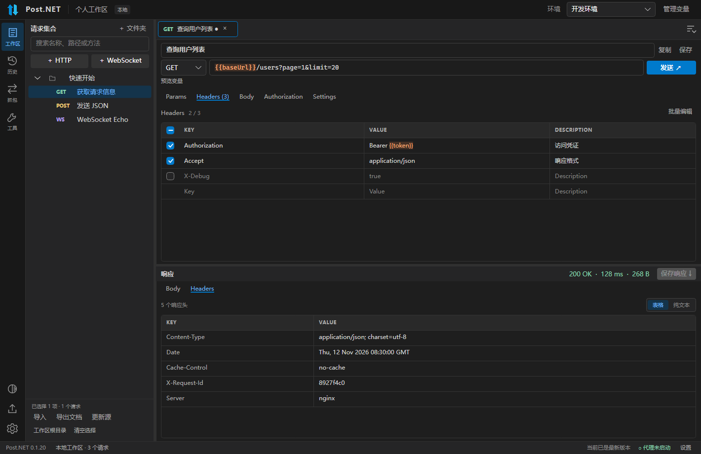

截图使用 Avalonia Headless + Skia 渲染真实界面，展示测试响应数据。

三套主题共用圆角、边框、控件尺寸和表格样式。侧栏主题按钮按深色 → 浅色 → 午夜蓝依次切换，也可在设置中直接选择；偏好保存在本地，旧版本的深浅主题配置继续有效。

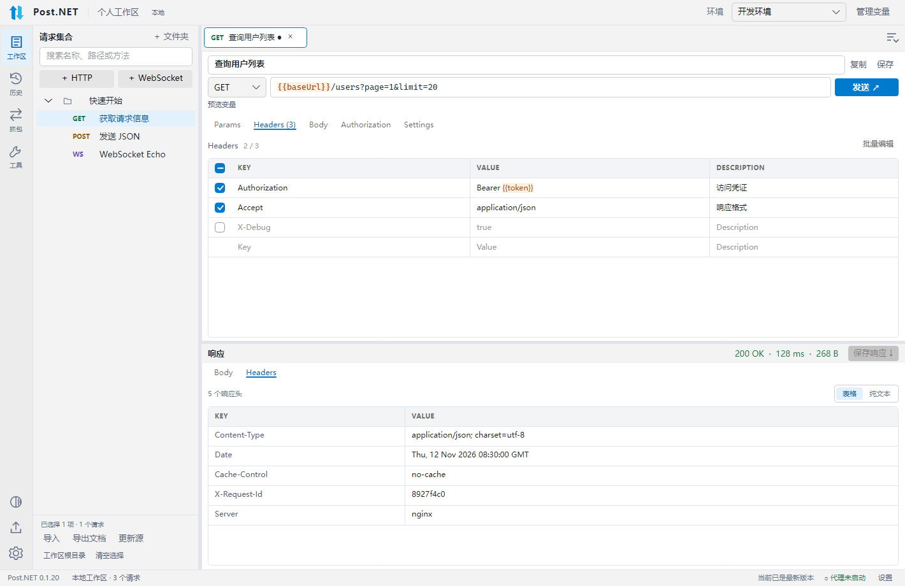

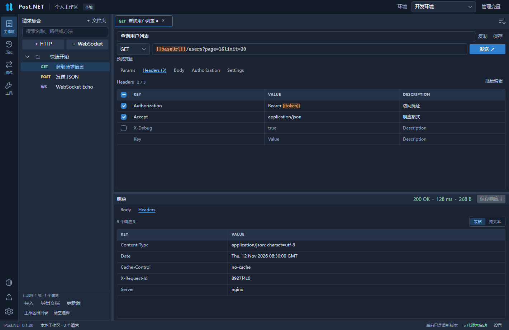

## 安装

| 系统 | 架构 | 下载文件 |
| --- | --- | --- |
| Windows | x64 | `Post.NET-win-x64-Setup.exe` |
| Linux | x64 | `Post.NET-linux-x64.AppImage`，执行前使用 `chmod +x` |
| macOS | ARM64（Apple Silicon） | `.dmg` 或 `Post.NET-osx-arm64-Portable.zip`，将应用复制到 Applications |

安装包自带运行时，无需安装 .NET。安装包均未签名，不通过应用商店分发。macOS 首次打开时，在“系统设置 → 隐私与安全性”中允许打开；应用应放在当前用户可写的位置，以便更新。Linux 的 CI 构建基线为 Ubuntu 24.04；部分发行版运行 AppImage 需要 FUSE。

Windows 从 0.1.1 起，再次运行 Setup.exe 会直接覆盖安装/修复，同版本也可修复缺失的程序文件，不再弹出“已经安装”的确认。安装时会关闭已有实例，完成后打开应用；工作区、环境、历史和本地 CA 保留在独立的数据目录。命令行支持 `--silent`（不自动启动）、`--no-start`、`--installto <目录>` 和 `--log <文件>`。

## 启动

安装 .NET 10 SDK 后，在项目目录运行：

```sh
dotnet restore
dotnet run --project src/PostNet.Desktop
```

测试（本地 IndexedDB 解码集成测试另需 PATH 中有 Node.js 22；正式应用优先使用已安装原软件自带的 Electron，无需用户另装 Node.js）：

```sh
dotnet test PostNet.sln
```

UI 测试通过 Avalonia Headless + Skia 渲染真实 XAML，快照保存在 `artifacts/screenshots`。这些是无窗口渲染快照，不代表已在所有目标系统/架构上完成实机验证。

测试覆盖真实 HTTP/HTTPS、WebSocket、代理、增量导入、SQLite、文件上传/下载、URL 与参数双向同步、文本工具及 MVVM/界面渲染。Windows x64、Linux x64、macOS ARM64 的 Native AOT 安装包由 GitHub Actions 构建，实际结果见对应的工作流。自动化测试不等于所有系统的安装和升级流程均已完成实机验证。

v0.1.0 验证记录：

- Windows、Linux、macOS 均通过 32 项自动化测试（24 项服务/网络测试 + 8 项桌面测试）。
- 六个 RID 的 Native AOT 编译、Velopack 打包及 Release 上传全部成功，见[发布工作流](https://github.com/coolqingcheng/Post.NET/actions/runs/42586154097)。
- Windows x64 原生程序已在本机验证启动、工作区数据库创建和正常退出。
- 使用 Velopack 测试定位器模拟旧版本，已从公开 GitHub Releases 检查、下载并校验真实的 Windows x64 更新包，无需访问令牌；这项检查未执行应用替换和重启。

v0.1.1 的[发布工作流](https://github.com/coolqingcheng/Post.NET/actions/runs/42589146970)已完成六个平台打包，Windows/Linux/macOS 均通过 35 项测试。Windows x64 另执行了真实安装集成测试：从 0.1.0 覆盖升级、同版本再次安装、缺失文件修复，以及旧数据库、WAL、本地 CA 和修复后新增数据的保留，全部通过。

v0.1.2 的[发布工作流](https://github.com/coolqingcheng/Post.NET/actions/runs/42597343331)已完成六个平台的 Native AOT 打包及发布；Windows/Linux/macOS 的[测试工作流](https://github.com/coolqingcheng/Post.NET/actions/runs/42597319162)均通过 51 项测试（41 项服务/网络 + 10 项桌面）。Windows x64 另通过从 0.1.0 覆盖升级、同版本修复及数据库/WAL/CA 保留测试。六个架构的公开更新索引均指向 0.1.2，使用模拟旧版本定位器已从 GitHub 无令牌检查、下载并校验 Windows x64 更新包；该下载验证不执行应用替换或重启。

v0.1.3 的[测试工作流](https://github.com/coolqingcheng/Post.NET/actions/runs/42603067258)在 Windows/Linux/macOS 均通过 69 项自动化测试（51 项服务/网络 + 18 项桌面），覆盖文件上传、在线文档、双向参数同步、深浅主题和文本工具。[发布工作流](https://github.com/coolqingcheng/Post.NET/actions/runs/42603098585)已完成六个平台的 Native AOT 打包和发布，Windows x64 的 0.1.0 → 0.1.3 覆盖升级、重复修复及数据库/WAL/CA 保留验证均通过。六个公开更新索引已核对为 0.1.3，并使用模拟旧版本定位器，从 GitHub 无令牌下载并校验 Windows x64 更新包；这项客户端验证不执行应用替换或重启。

v0.1.4 的[测试工作流](https://github.com/coolqingcheng/Post.NET/actions/runs/42621120142)在 Windows/Linux/macOS 均通过 71 项测试，六个桌面 Native AOT 目标构建及发布成功。Windows x64 的覆盖升级、同版本修复、缺失文件恢复及数据库/WAL/CA 保留验证通过。

v0.1.5 至 v0.1.9 构建和发布 Windows、Linux、macOS 六个桌面目标，停止 Android 打包。从 v0.1.10 起只构建 Windows x64、Linux x64 和 macOS ARM64 三个目标。

v0.1.5 的[测试工作流](https://github.com/coolqingcheng/Post.NET/actions/runs/42633425399)在 Windows/Linux/macOS 均通过 82 项测试（58 项服务/网络 + 24 项界面/MVVM），覆盖导出范围、递归多选去重、未保存内容、Markdown 转义及 PDF 生成。PDF 三页样张已渲染检查，中文复制、长参数跨页和重复表头均验证通过。[发布工作流](https://github.com/coolqingcheng/Post.NET/actions/runs/42636719580)已完成六个桌面 Native AOT 目标；Windows x64 覆盖升级、同版本修复、缺失文件恢复及数据库/WAL/CA 保留验证通过。六个公开更新索引均为 0.1.5，模拟旧版本客户端已无需令牌下载并校验 Windows x64 更新包，此项验证不执行应用替换或重启。macOS ARM64 公开包的 SHA256 和 Mach-O ARM64 架构已核对，尚未进行 Apple Silicon 实机安装验证。

v0.1.6 的[测试工作流](https://github.com/coolqingcheng/Post.NET/actions/runs/42650191232)在 Windows/Linux/macOS 均通过 88 项测试（60 项服务/网络 + 28 项界面/MVVM），覆盖空行新增与焦点保持、Tab 导航、深浅主题渲染、长文件路径列对齐、Bulk Edit 发送/保存/草稿以及参数描述往返。[发布工作流](https://github.com/coolqingcheng/Post.NET/actions/runs/42650243719)已完成六个桌面 Native AOT 目标；Windows x64 覆盖升级、同版本修复、缺失文件恢复及数据库/WAL/CA 保留验证通过。六个公开更新索引均为 0.1.6，模拟旧版本客户端已无需令牌下载并校验 Windows x64 更新包，此项验证不执行应用替换或重启。

v0.1.7 的[测试工作流](https://github.com/coolqingcheng/Post.NET/actions/runs/42738255990)在 Windows/Linux/macOS 均通过 92 项测试（60 项服务/网络 + 32 项界面/MVVM），覆盖工作区 Ctrl/⌘ 多选、单行标签滚动与模糊搜索、侧栏图标首次渲染，以及 WebSocket 参数表格、批量编辑和消息高亮。[发布工作流](https://github.com/coolqingcheng/Post.NET/actions/runs/42738282235)已完成六个桌面 Native AOT 目标并发布 35 个文件；Windows x64 的 0.1.0 → 0.1.7 覆盖升级、同版本修复、缺失文件恢复及数据库/WAL/CA 保留验证通过，安装包、启动器和主程序的网络 Logo 也通过逐像素比对。六个公开更新索引均为 0.1.7，SHA256 清单与发布文件摘要一致；模拟旧版本客户端已无需令牌下载并校验 Windows x64 更新包，此项验证不执行应用替换或重启。

v0.1.8 的[测试工作流](https://github.com/coolqingcheng/Post.NET/actions/runs/42743979186)在 Windows/Linux/macOS 均通过 96 项测试（60 项服务/网络 + 36 项界面/MVVM），覆盖标签右键菜单点击、按目标标签关闭其他/左右标签、全部关闭、菜单置灰、保存/放弃/取消、无效批量编辑、WebSocket 断开和重复关闭保护。[发布工作流](https://github.com/coolqingcheng/Post.NET/actions/runs/42744005841)已完成六个桌面 Native AOT 目标；Windows x64 覆盖升级、同版本修复、缺失文件恢复、数据库/WAL/CA 保留及网络 Logo 比对均通过。六个公开更新索引均为 0.1.8，索引中的大小、SHA256 及发布校验清单均与发布文件摘要一致；模拟旧版本客户端已无需令牌下载并校验 Windows x64 更新包，此项验证不执行应用替换或重启。

v0.1.9 的[测试工作流](https://github.com/coolqingcheng/Post.NET/actions/runs/43165089538)在 Windows/Linux/macOS 均通过 113 项测试（76 项服务/网络 + 37 项界面/MVVM），新增覆盖省略 HTTP 协议的真实请求、域名/IP/端口、变量解析、查询参数、预览/历史一致性及显式 HTTPS 保留。[发布工作流](https://github.com/coolqingcheng/Post.NET/actions/runs/43165150609)已完成六个桌面 Native AOT 目标；Windows x64 覆盖升级、同版本修复、缺失文件恢复、数据库/WAL/CA 保留及图标比对均通过。六个公开更新索引均为 0.1.9，大小、SHA256 和发布校验清单已核对；模拟旧版本客户端已无需令牌下载并校验 Windows x64 更新包，此项验证不执行应用替换或重启。

v0.1.10 的[测试工作流](https://github.com/coolqingcheng/Post.NET/actions/runs/43169564006)在 Windows/Linux/macOS 均通过 115 项测试（76 项服务/网络 + 39 项界面/MVVM），新增 Headless 鼠标点击和输入回归，覆盖 HTTP/WebSocket 参数表格、草稿行新增、长值横向滚动、中文、变量及选中替换。[发布工作流](https://github.com/coolqingcheng/Post.NET/actions/runs/43170030284)仅构建 Windows x64、Linux x64、macOS ARM64 三个 Native AOT 目标，已发布 18 个文件；Windows x64 覆盖升级、同版本修复、缺失文件恢复、数据库/WAL/CA 保留及图标比对均通过。三个公开更新索引均为 0.1.10，大小、SHA256 和发布校验清单已核对；模拟旧版本客户端已无需令牌下载并校验 Windows x64 更新包，此项验证不执行应用替换或重启。

v0.1.11 的[测试工作流](https://github.com/coolqingcheng/Post.NET/actions/runs/43173394863)在 Windows/Linux/macOS 均通过 117 项测试（76 项服务/网络 + 41 项界面/MVVM），覆盖更新说明随目标版本切换、缺省说明、稍后重新查看，以及长说明滚动时升级按钮保持可见。[发布工作流](https://github.com/coolqingcheng/Post.NET/actions/runs/43173451093)已完成三个 Native AOT 目标并发布 18 个文件，Windows x64 覆盖安装、同版本修复、缺失文件恢复及数据库/WAL/CA 保留验证通过。GitHub 发布页与三个公开更新索引的更新说明均与源文件一致，更新包大小、SHA256 和发布校验清单已核对；模拟旧版本客户端已无需令牌下载、校验 Windows x64 更新包并读取完整更新说明，此项验证不执行应用替换或重启。

v0.1.12 的[测试工作流](https://github.com/coolqingcheng/Post.NET/actions/runs/43179392296)在 Windows/Linux/macOS 均通过 134 项测试（89 项服务/工具/网络 + 45 项界面/MVVM），新增覆盖秒/毫秒与负数时间戳、时区与闰日、夏令时歧义、Cron 模板及执行预览，以及 JSON/XML/HTML/普通文本响应换行时原文保留。工具的深浅主题、紧凑布局、状态栏对齐与更新圆圈已通过 Headless 渲染检查。[发布工作流](https://github.com/coolqingcheng/Post.NET/actions/runs/43179393812)已完成三个 Native AOT 目标并发布 18 个文件，Windows x64 覆盖安装、同版本修复、缺失文件恢复及数据库/WAL/CA 保留验证通过。三个公开更新索引、更新说明、包大小和 SHA256 校验清单已核对；模拟旧版本客户端已无需令牌下载、校验 Windows x64 更新包并读取完整更新说明，此项验证不执行应用替换或重启。

v0.1.13 的[测试工作流](https://github.com/coolqingcheng/Post.NET/actions/runs/43184996059)在 Windows/Linux/macOS 均通过 153 项测试（102 项服务/工具/网络 + 51 项界面/MVVM），覆盖格式化/压缩、数字与转义保留、多兆字节 JSON 的后台处理与取消、旧任务失效，以及响应原文、下载和历史保留。[发布工作流](https://github.com/coolqingcheng/Post.NET/actions/runs/43184997700)已完成三个 Native AOT 目标并发布 18 个文件，Windows x64 覆盖安装、同版本修复、缺失文件恢复及数据库/WAL/CA 保留验证通过。三个更新索引、更新说明、包摘要及校验清单已核对；模拟旧版本客户端已无需令牌下载、校验 Windows x64 更新包并读取完整说明，此项验证不替换或重启应用。另通过 Windows x64/Linux x64 的[原生运行检查](https://github.com/coolqingcheng/Post.NET/actions/runs/43186375089)，实际执行 JSON/XML/HTML/JavaScript/CSS 格式化、压缩及无效 JavaScript 报错；NUglify 的反射辅助代码仍产生裁剪告警，此检查覆盖当前使用的调用路径，macOS 的对应功能尚未做原生运行检查。

v0.1.14 的[测试工作流](https://github.com/coolqingcheng/Post.NET/actions/runs/43189979115)在 Windows/Linux/macOS 均通过 156 项测试（102 项服务/工具/网络 + 54 项界面/MVVM），新增覆盖响应头重复字段、冒号与原文保留、鼠标切换表格/纯文本、历史刷新、三套主题即时切换与保存，以及表头半选、鼠标全选和空格键停用。三套主题、紧凑布局和小窗口响应头视图已通过 Headless 渲染检查。[发布工作流](https://github.com/coolqingcheng/Post.NET/actions/runs/43190007463)已完成三个 Native AOT 目标并发布 18 个文件；Windows x64 覆盖安装、同版本修复、缺失文件恢复、数据库/WAL/CA 保留及图标一致性验证通过。三个公开更新索引、更新说明、包大小、SHA256 和发布校验清单已核对；模拟旧版本客户端已无需令牌下载、校验 Windows x64 更新包并读取本次更新说明，此项验证不替换或重启应用。

v0.1.15 的[测试工作流](https://github.com/coolqingcheng/Post.NET/actions/runs/43195224516)在 Windows/Linux/macOS 均通过 156 项测试（102 项服务/工具/网络 + 54 项界面/MVVM），新版奶油小狗图标已完成三套主题的 Headless 渲染检查，PNG 与九种 ICO 尺寸的透明边缘已核对。[发布工作流](https://github.com/coolqingcheng/Post.NET/actions/runs/43195276860)已完成三个 Native AOT 目标并发布 18 个文件；Windows x64 覆盖安装、同版本修复、缺失文件恢复和数据库/WAL/CA 保留验证通过，安装器、启动器及主程序的新图标通过逐像素比对。三个公开更新索引、更新说明、包大小、SHA256 与发布校验清单已核对；模拟旧版本客户端已无需令牌下载、校验 Windows x64 更新包并读取本次说明，此项验证不替换或重启应用。

v0.1.16 的[测试工作流](https://github.com/coolqingcheng/Post.NET/actions/runs/43200295961)在 Windows/Linux/macOS 均通过 156 项测试（102 项服务/工具/网络 + 54 项界面/MVVM）。双向数据流图标、发送按钮文字及加载动画居中已通过 Headless 渲染检查。[发布工作流](https://github.com/coolqingcheng/Post.NET/actions/runs/43200296852)已完成三个 Native AOT 目标并发布 18 个文件；Windows x64 覆盖安装、同版本修复、缺失文件恢复和数据库/WAL/CA 保留验证通过，安装器、启动器及主程序的图标通过逐像素比对。三个公开更新索引、更新说明、包大小、SHA256 与发布校验清单已核对；模拟旧版本客户端已无需令牌下载、校验 Windows x64 更新包并读取本次说明，此项验证不替换或重启应用。

v0.1.17 的[测试工作流](https://github.com/coolqingcheng/Post.NET/actions/runs/43222256906)在 Windows 通过 159 项测试（102 项服务/工具/网络 + 57 项界面/MVVM/系统集成）；Linux/macOS 各通过 156 项，跳过 3 项 Windows 专用测试。新增覆盖重命名的任务栏快捷方式、同版本新固定项、参数保留，以及损坏/占用快捷方式的重试。[发布工作流](https://github.com/coolqingcheng/Post.NET/actions/runs/43222364404)已完成三个 Native AOT 目标并发布 18 个文件；Windows x64 原生安装器及主程序启动均通过快捷方式图标修复验证，保留中文目标路径、启动参数及 AppUserModelID，覆盖安装、同版本修复和数据库/WAL/CA 保留检查也通过。三个公开更新索引、更新说明、包大小、SHA256 与校验清单已核对；模拟旧版本客户端已无需令牌下载并校验 Windows 更新包、读取本次说明，此项验证不替换或重启应用。

v0.1.18 的[测试工作流](https://github.com/coolqingcheng/Post.NET/actions/runs/43345735707)在 Windows 通过 159 项测试，Linux/macOS 各通过 156 项并跳过 3 项 Windows 专用测试。左侧树的 24 px 行距已完成三套主题的 Headless 渲染检查，Ctrl/⌘ 多选、普通点击切换、右键保留选择及搜索后选择恢复测试通过。[发布工作流](https://github.com/coolqingcheng/Post.NET/actions/runs/43345760642)已完成三个 Native AOT 目标并发布 18 个文件；Windows 覆盖安装、同版本修复、数据保留及原生快捷方式图标检查通过。三个公开更新索引、更新说明、包大小、SHA256 和校验清单已核对；模拟旧版本客户端已下载并校验 Windows 更新包、读取本次说明，此项验证不替换或重启应用。

v0.1.19 的[测试工作流](https://github.com/coolqingcheng/Post.NET/actions/runs/43350270523)在 Windows 通过 159 项测试，Linux/macOS 各通过 156 项并跳过 3 项 Windows 专用测试。三套主题的约 28 px 树行距、圆角选中背景、默认控件强调色及主题切换后选择保留已通过 Headless 交互与渲染检查；侧栏、地址栏、标签和表格密度同步调整。[发布工作流](https://github.com/coolqingcheng/Post.NET/actions/runs/43350283268)已完成三个 Native AOT 目标并发布 18 个文件，Windows 覆盖安装、同版本修复、数据保留和原生快捷方式图标检查通过。三个公开更新索引、更新说明、包大小、SHA256 与校验清单已核对；模拟旧版本客户端已无需令牌下载并校验 Windows 更新包、读取本次说明，此项验证不替换或重启应用。

## 已实现

- 多级文件夹：新建、重命名、删除、拖动移动；请求支持 HTTP 和 WebSocket。左侧树采用约 28 px 行距，选中背景使用主题蓝色和 4 px 圆角；与侧栏、输入框、标签和参数表保持协调的密度。
- 每个请求独立标签页；清晰边框区分当前与其他标签，固定单行、横向滚动；右侧“全部标签”支持名称/方法/URL 模糊搜索及快速切换。右键支持关闭、关闭其他、关闭左侧、关闭右侧和全部关闭；支持保存、复制、草稿恢复和 Ctrl+N、Ctrl+S、Ctrl+W。
- HTTP 方法、URL 与 Params 双向同步，省略协议时默认使用 `http://`；Query/Header/Form 参数采用 Postman 风格的 KEY / VALUE / DESCRIPTION 表格，底部空行新增、悬停删除、全选启停和 Bulk Edit；支持重复查询参数、Bearer Token、重定向控制、发送动画、取消和响应查看。
- URL、参数、Header、认证和请求体中的 `{{变量}}` 高亮；JSON/XML/HTML 语法高亮和 JSON/XML 格式化，支持 JSON、XML、Text、HTML、JavaScript 请求体类型。显式填写的 Content-Type 优先于类型默认值；Multipart 保留客户端生成的边界。
- Multipart 混合文本与文件上传，支持同名字段上传多个文件、变量文件路径、文件选择与流式发送。
- 深色/浅色/午夜蓝三套主题，切换并记住选择；统一 4 px 圆角、细边框、紧凑间距，输入框、参数表格、勾选框和代码高亮随主题变化。
- 响应 Headers 默认显示 KEY / VALUE 表格，可切换纯文本；长值自动换行，可选择复制，保留字段顺序、重复字段和原始内容。
- 本地工具：JSON 格式化/压缩、URL 参数编码/解码、UTF-8 Base64 编码/解码、秒/毫秒时间戳与日期双向转换、Cron 表达式解析和生成。
- HTTP 文本响应与响应头按面板宽度自动换行，保留原始内容及语法高亮；更新检查与下载使用状态栏旋转圆圈，底部文字统一垂直对齐。
- 响应 Body 支持 JSON/XML/HTML/JavaScript/CSS 格式化、压缩及恢复原文，可手动选择类型；JSON 工具与响应处理在后台运行，支持取消，大文本自动跳过语法着色。
- 文件响应完整流式接收，自动提示保存到本地；取消选择后仍可点击“保存响应”。文本响应也可保存原始内容，无需重新发送请求。
- WebSocket：ws/wss，与 HTTP 一致的 Params / Headers / Body / Authorization / Settings；共享三列参数表、空行新增和 Bulk Edit，消息支持 JSON/XML/Text/HTML/JavaScript 高亮、格式化及 Base64 二进制，保留子协议、双向消息及会话历史。
- 公共变量及环境变量，使用 `{{baseUrl}}`、`{{token}}` 等引用；支持嵌套引用，缺失或循环引用会阻止发送。
- SQLite 保存工作区和历史；历史可按时间、方法、环境、执行结果、URL/名称/文件夹关键词筛选，恢复后不会自动发送。
- Swagger 2.0、OpenAPI 3.0/3.1 JSON 支持从本地文件或在线 HTTP/HTTPS 链接导入到选定文件夹；按首个 tag 分组；导入源绑定、增量更新、字段冲突预览、来源移除标记。
- Postman Collection v2 / v2.1、旧版自动备份、环境/公共变量，以及 ApiPost 项目/单请求 JSON 导入；保留目录、请求、启用状态、原始请求体和表单文本/文件字段。
- 检测本机 ApiPost / Postman，在导入窗口选择后直接读取本地数据副本；支持本地导入源刷新及增量合并。
- 文档导出支持 Markdown、PDF 和 OpenAPI JSON；按住 Ctrl 点击选择多个文件夹/请求（macOS 使用 ⌘），文件夹递归包含全部子项，重叠选择自动去重。PDF 内置中文字体，长参数表格自动分页。OpenAPI 3.0.3 保留模型引用，通过 `x-apinet-*` 扩展恢复文件夹及 WebSocket 配置。
- 本地 HTTP/1.1 正向代理、HTTPS CONNECT 隧道、可选 HTTPS 解密、WebSocket 帧转发及查看、抓包转调试。
- 关闭时退出或隐藏到托盘；Windows/macOS 提供托盘菜单，Linux 关闭到托盘选项当前回退为最小化窗口。
- Velopack 检查更新、后台自动下载、立即重启升级/退出时升级；检查及下载状态显示在底部状态栏，仅更新下载就绪后弹出版本号、更新内容及升级选择。开发运行不会尝试安装更新。

## 基本使用

左侧选择文件夹后新建请求，或点击“导入”/右键“导入到此文件夹”。选择“工作区根目录”后，可在根目录新建文件夹或导出整个工作区。每个导入源保存文件路径、在线 JSON 地址或本机数据目录，再次导入同一来源到同一文件夹会增量更新；文件迁移时需重新选择导入源。

### 选择文档范围并导出

在左侧集合树中直接点击选中一行，按住 Ctrl 再点击可跨目录多选或取消其中一项（macOS 使用 ⌘），无需选择框。多选操作不会打开额外请求标签，普通点击会切回单选并打开请求；右键已选行保留整个选择范围，可直接导出。

选择父文件夹会包含全部下级请求，即使它们当前被折叠或搜索隐藏；重叠选择只导出一次。底部显示选中项数和实际请求数，支持“清空选择”；搜索、主题切换及集合刷新后保留选择。

点击“导出文档”使用当前选择的文件夹/请求；点击“工作区根目录”会清空选择并切换为整个工作区。格式选择窗口确认范围和请求数量，然后在系统保存窗口选择本地目录。

- **Markdown (.md)**：按文件夹路径分组，包含 URL、Query、Headers、表单字段、请求体、WebSocket 子协议，以及导入源中可用的描述、响应定义和引用模型。
- **PDF (.pdf)**：与 Markdown 使用相同内容，内置中文字体；长 URL、长参数和表格自动换行/分页，跨页表格重复表头。
- **OpenAPI JSON (.json)**：适合继续导入 Swagger 等工具；保留相关模型引用和 Post.NET 文件夹/WebSocket 扩展。

导出使用已打开标签页的当前编辑内容，无需先保存；变量保留为占位符，标记为敏感的值脱敏，常见认证/Cookie 头和本机上传路径不写入文档。历史记录、抓包和实际响应内容不参与文档导出；普通手动请求未定义的响应结构不会自动推断。

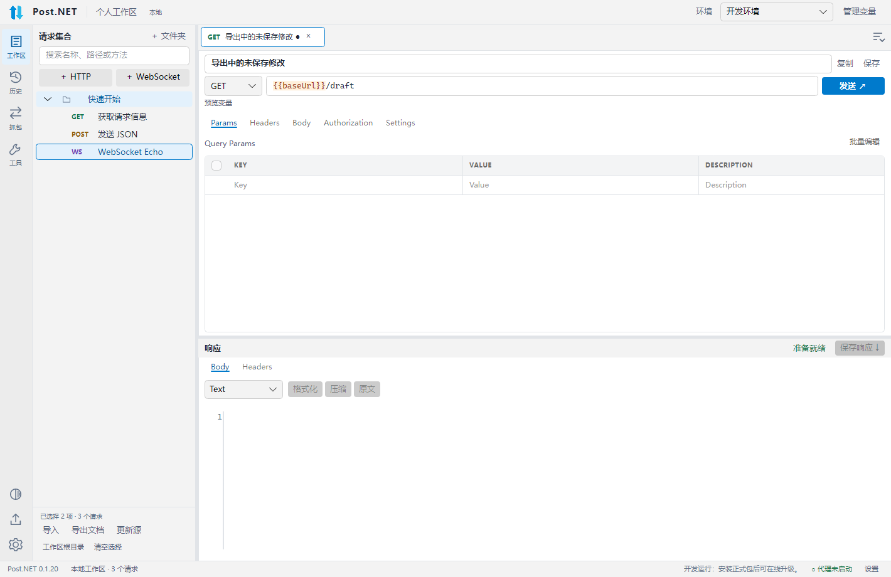

请求标签始终保持一行，可通过滚动条、触控板或鼠标滚轮横向浏览。右上角的列表按钮展示所有打开的标签；输入名称、HTTP 方法或 URL 可模糊搜索，支持不连续字符和多个关键词，点击结果或按 Enter 切换，选中的标签会自动滚动到可见位置。

右键任意标签可选择“关闭其他标签”“关闭左侧标签”“关闭右侧标签”或“全部关闭”，范围以右键点击的标签及当前排列为准；没有可关闭项时，相应菜单置灰。批量关闭逐项处理未保存修改和 WebSocket 断开确认，选择“取消”或保存失败时停止后续关闭，已关闭的标签不会重新打开。关闭标签只移除打开的页面，集合中的请求仍然保留。

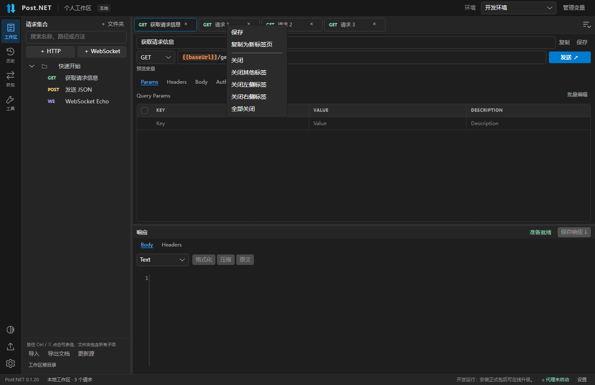

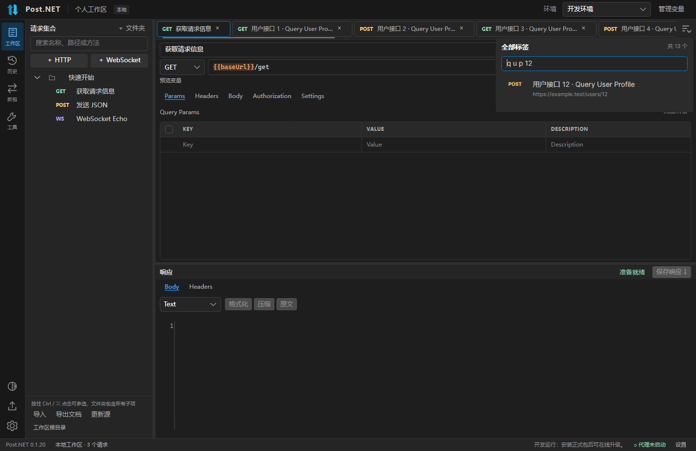

WebSocket 的 Headers 与 HTTP 共用同一个参数编辑组件，Body 可选择文本格式、格式化并发送消息，接收/发送记录显示在下方；修改连接参数后需要重新连接。

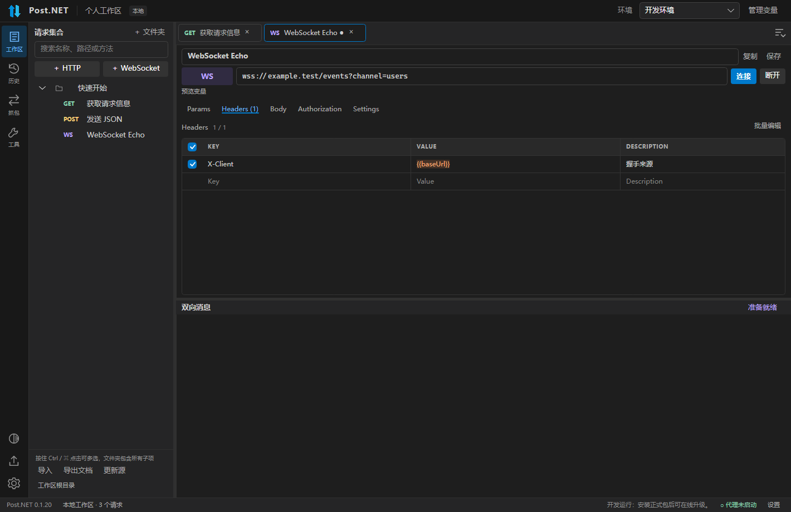

在顶部“管理变量”中配置公共变量和开发/测试等环境。当前环境覆盖公共变量。导入的新服务会在需要时创建独立的 `import_xxxxxx.baseUrl`，避免复用已有服务地址。路径参数如 `{{id}}` 需要在变量中配置。

HTTP 地址省略协议时默认使用 `http://`，例如 `localhost:8080/api` 会请求 `http://localhost:8080/api`；域名、IP、带端口地址以及变量解析后的地址均支持，也可填写 `//example.com/api`。显式填写的 `https://` 保留；预览和历史显示实际请求地址，输入框和已保存的变量表达式保留原样。

Query、Headers 和表单参数使用 KEY / VALUE / DESCRIPTION 三列表格，表头 30 px、数据行约 33 px。直接在底部空行输入即可新增，悬停行时显示删除按钮；左侧勾选启停，表头支持全选，Tab / Shift+Tab 切换单元格。半选时点击表头会全部启用，全选后点击则全部停用。表头底色、细分隔线、主题色焦点边框及参数描述适配全部三套主题，HTTP 与 WebSocket 共用同一组件。

v0.1.10 修复鼠标点击和编辑参数单元格时的栈溢出崩溃：单行编辑器禁用纵向滚动，避免光标定位与鼠标选区递归触发滚动；长值仍可横向滚动，变量高亮、中文输入和选中替换保留。

右上角“批量编辑”可按每行 `key: value` 批量编辑，`// ` 开头表示停用；保留重复 key、顺序以及匹配行的描述和文件类型。发送、保存和草稿持久化会使用有效的批量修改，无需先切回表格；格式错误直接显示在编辑区，发送/保存前需修正，点击“取消”可丢弃尚未应用的批量文本。描述会随 Postman / ApiPost / OpenAPI 导入，保存到本机并包含在文档导出中。

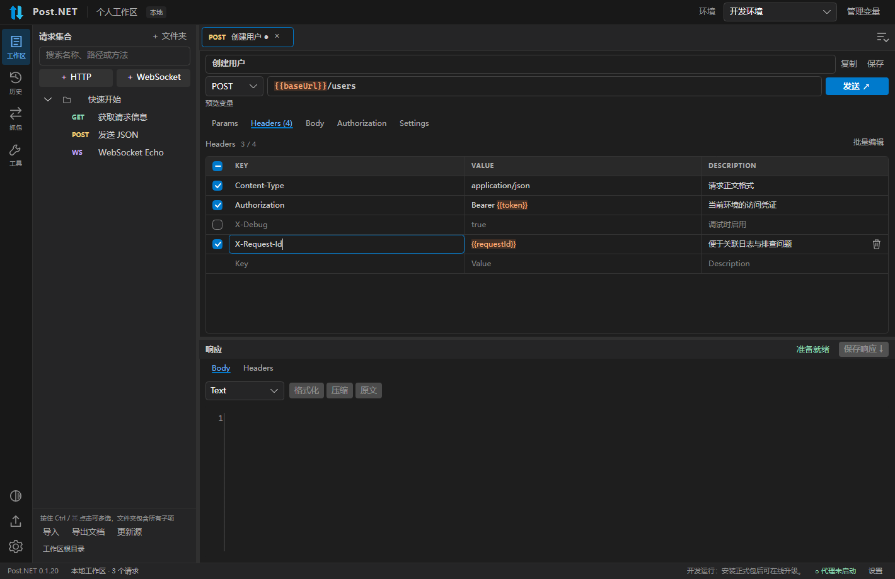

粘贴/编辑 URL 中的查询参数会自动填入 Params，编辑 Params 也会更新 URL；重复 key、空值、`{{变量}}` 和 `#fragment` 均保留。取消勾选会从 URL 中移除此项，但在表格中保留供再次启用，实际发送不会重复追加。Query 值在解析变量后进行 URL 编码。自动跟随重定向位于请求的 `Settings` 标签页。

Body 类型会自动设置默认 Content-Type，Headers 中手动指定的值会覆盖默认值；Multipart 的 Content-Type 和 boundary 统一由客户端生成，避免导入的裸 Content-Type 破坏上传。JSON/XML 高亮在编辑期间生效，`{{变量}}` 单独以橙色突出显示。输入框具有一致的左右留白和焦点边框。

Body 另支持 `Form URL Encoded` 和 `Multipart`。选择 Multipart 后，在 KEY 列内切换 `Text` / `File`；File 行点击 VALUE 列的“选择文件”选择本机文件。相同 key 添加多条 File 行即可上传多个文件，也可与文本字段混合。文件按流读取，变量在读取/编码前解析；文件不存在会提示重新选择，取消请求会停止上传。Form URL Encoded 不支持文件，选中 File 行时会提示改用 Multipart。

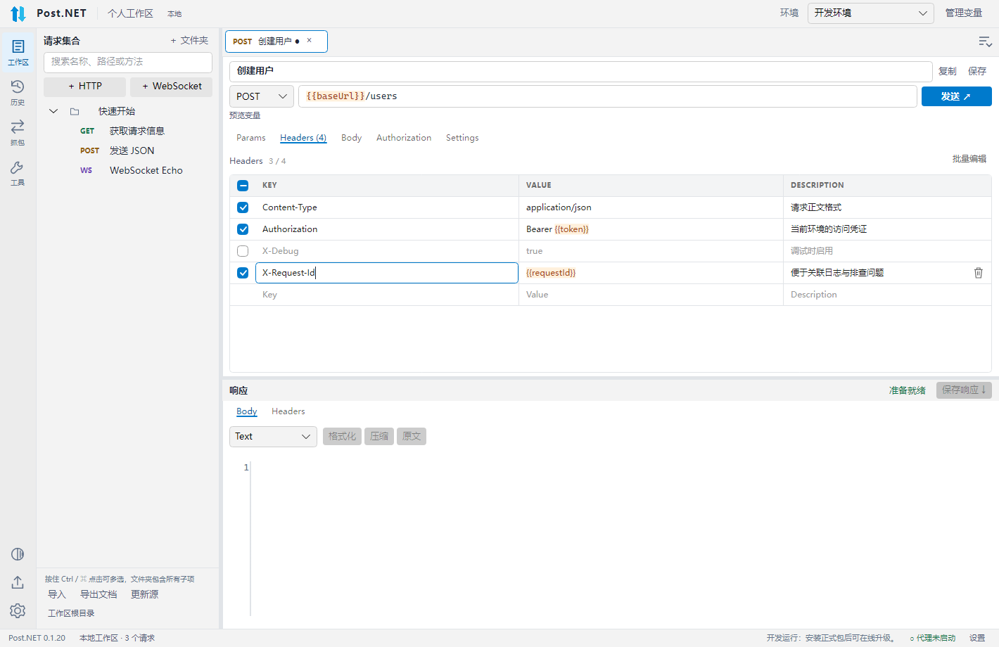

左侧 `◐` 按钮可立即切换深色/浅色，或在设置中选择主题，重启后恢复。左侧“工具”提供 JSON 格式化/压缩、URL 编码/解码和 Base64 编码/解码，支持复制结果、清空与结果填回输入，切换工具不会关闭请求标签页。URL 工具按参数组件编码，解码时将 `+` 还原为空格。

JSON 格式化和压缩在后台逐 token 读写，保留大整数及字符串内容，处理期间可取消；修改输入或切换工具会取消旧任务，避免旧结果覆盖新输入。超过约 100 万字符的编辑内容跳过语法着色，仍保留完整文本、选择复制和滚动。格式化后的结果仍完整显示，可复制或填回输入。

v0.1.13 的本机核心处理对比：10.87 MiB UTF-8 JSON、150,000 条含中文/大整数/数组的记录，Release 模式预热后各执行 3 次，平均格式化耗时由 221 ms 降为 84 ms，单次托管内存分配由 147.97 MiB 降为 111.49 MiB。结果的完整 JSON 数据已比对一致；此数字不包含编辑器显示耗时，也不代表进程峰值内存或所有数据规模的表现。

响应 Headers 提供 [KEY / VALUE 表格](docs/images/response-headers-table.png) 与 [纯文本](docs/images/response-headers-text.png) 两种视图，可选择复制，长值自动换行；切换保留原文，每个请求独立切换视图。

响应 Body 顶部提供类型选择、格式化、压缩、原文及处理期间的取消按钮，支持 JSON、XML、HTML、JavaScript 和 CSS。Content-Type 不准确时可手动选择；纯文本不删除空白。操作只调整当前显示，保存响应仍下载原始字节，历史与请求内容保持原样；收到新响应或关闭标签会取消旧处理。

“时间戳 / 日期转换”支持整数秒和毫秒、负数时间戳、一键填入当前时间、本地时区与 UTC。没有偏移的日期按所选时区解析；ISO 8601 日期中的 `Z`、`+08:00` 等偏移优先生效。结果同时显示秒、毫秒、本地日期和 UTC 日期，支持复制。夏令时不存在或重复的本地时间会要求明确时间或偏移。

“Cron 解析 / 生成”支持 5 段（分 时 日 月 周）和 6 段（秒 分 时 日 月 周），提供每分钟、每小时、每天、工作日、每周、每月等模板，也可手动填写范围、列表和步长。解析后显示字段含义及所选时区下接下来 10 次执行时间，可复制表达式和结果。采用 Cronos 规则：周日为 0 或 7，日与周同时指定时取交集；支持 `L`、`W`、`#`，不支持年份、随机偏移 `H` 和 Quartz 星期编号。这些工具只做本地计算，不会创建定时任务。

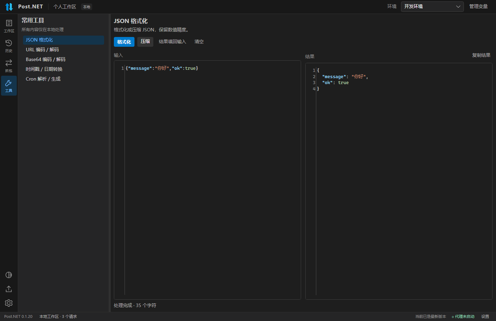

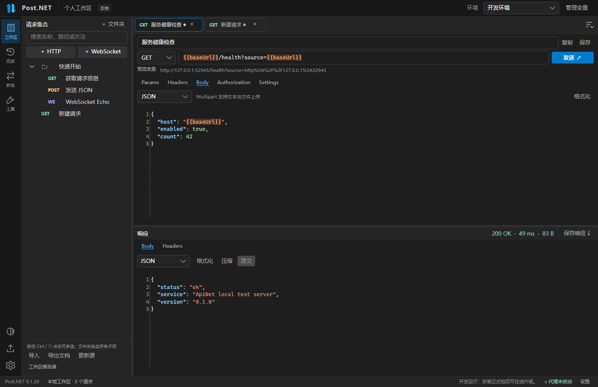

修改请求后点击保存或 Ctrl+S。退出应用会保留未保存草稿，重启后恢复标签页；网络连接不会自动重连。历史恢复的数据可能已脱敏，重新发送前需补充认证信息。

## 从 ApiPost / Postman 导入

导入窗口自动列出检测到的软件和残留本地数据。选中软件并点击“一键导入”，即可查看预览并导入到当前文件夹，无需先手动导出。也可点击“在线 JSON 链接…”导入 `https://example.com/v3/api-docs` 或 `swagger.json`，或点击“选择 JSON 文件”，导入 Swagger/OpenAPI、Postman Collection/环境/自动备份或 ApiPost 项目 JSON。文件夹绑定多个导入源时，“刷新导入源”会让你选择具体来源。

在线导入需要文档的 JSON 地址，Swagger UI 的 HTML 页面不能直接导入。支持重定向，下载上限 16 MB、超时 30 秒。来源会绑定到所选文件夹，点击“更新源”会重新下载并预览增量合并，保留本地修改，不重复创建相同请求。需要登录或自定义认证的文档可先下载再导入。

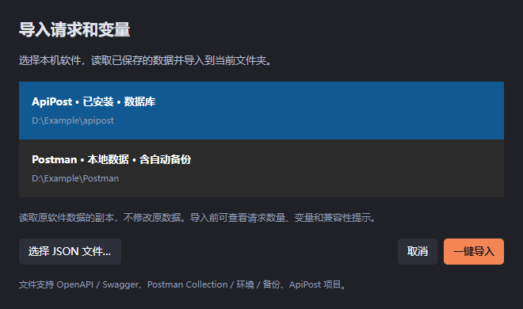

本地读取会复制 Chromium IndexedDB 的 LevelDB 文件，校验表、日志和当前清单，再通过原软件自带的 Electron/V8 解码。读取过程不获取原数据库锁，不写入原软件的数据目录，不运行请求或脚本；临时副本在结束后清理。优先读取当前数据库，无法完整读取时可回退到最新的 Postman 自动备份，预览会显示备份文件名，提醒核对数据时间。原软件正在写入时，建议先关闭后再导入。

Windows 检测常见安装位置及卸载注册表，macOS 检测 Applications，Linux 检测常见目录、PATH 和 Postman 的 Snap/Flatpak 数据目录。自定义数据目录、加密数据、尚未同步到本机的云端内容或改变存储结构的新版软件可能无法直接读取，此时使用 JSON 文件导入。本机已验证 ApiPost 8.2.5 的请求/文件夹读取以及 Postman 自动备份的环境导入；其他版本与 macOS/Linux 的真实软件数据仍需实机验证。

支持 Bearer、API Key、固定用户名密码的 Basic 认证和继承认证；含变量的 Basic、OAuth/Digest 等认证需手动配置。脚本、前后置任务、历史、执行结果不迁移；不支持的认证、请求体和 Cookie 参数会在预览中提示。导入的文件项保留字段名、File 类型及来源中的路径，并先停用；点击“选择文件…”确认本机文件后会自动启用。Swagger/OpenAPI 的 multipart binary 和 Swagger 2.0 file 字段也会识别为文件。导出 OpenAPI 使用标准 binary schema，多文件同名字段使用 binary 数组；导出的扩展保留文件字段但清空本机文件路径并停用，接收方重新选文件即可发送。Postman 独立 WebSocket 导出格式暂不支持，普通集合中的 ws/wss URL 会识别为 WebSocket 请求。

增量导入按来源请求标识合并，同一 URL 下的多个请求可分别保留；无标识时使用目录和位置定位，调整此类项目顺序可能被识别为新增。冲突可选保留本地或使用文档值；来源中移除的请求只标记，不自动删除。已有公共/环境变量保留本地值，并显示同名变量提示；新增变量会补入，导入后可在“管理变量”切换环境。不同项目的同名变量需要核对后调整。

## 代理抓包

默认监听 `127.0.0.1:8877`，启动后手动将客户端代理指向此地址。例如：

```sh
curl --proxy http://127.0.0.1:8877 http://example.com
```

HTTPS 默认透传 TLS；需要解密时，在设置中开启 HTTPS 解密，导出 CA 并由用户在客户端信任，再重启代理。程序不自动改写系统代理或信任库。CA 私钥保存在本地应用数据目录的 `certificates` 中。

HTTP 抓包和主动 HTTP 调试分别保留至多 1 MB、4 MB 的响应预览；代理继续转发完整响应，主动请求的完整响应流式写入临时文件供下载，不受预览限制。临时响应在下一次请求、关闭标签或退出时清理，历史不保存临时路径或二进制正文。WebSocket 抓包按帧展示，压缩帧/二进制帧显示 Base64。列表最多显示最近 1000 条抓包，主动 WebSocket 每次会话最多保留 1000 条消息。

## 数据目录

Windows 默认使用 `%LOCALAPPDATA%/ApiNetData` 保存数据，与 `%LOCALAPPDATA%/ApiNet` 中的安装文件分开。0.1.0 的工作区数据库、待提交的 SQLite WAL 和 `certificates` 会自动迁移；迁移不覆盖已有新版数据库，源文件保留到覆盖安装或用户自行清理。其他系统继续使用系统 LocalApplicationData 下的 `ApiNet`。

为保持旧版升级兼容，更名后沿用这些数据目录、`APINET_DATA_DIR`、Velopack 的 `ApiNet` 包标识和已安装启动程序名。界面、系统安装名称和公开安装包使用 Post.NET；OpenAPI 的 `x-apinet-*` 扩展继续兼容旧文件。

`workspace.db` 保存配置、草稿和历史。环境变量中的敏感值保存在本机数据库，历史中的常见认证头及标记为敏感的变量值会脱敏。可用 `APINET_DATA_DIR` 环境变量指定独立的数据目录，该目录应位于安装目录之外。Windows 安装日志默认保存在 `%LOCALAPPDATA%/ApiNetSetupLogs/setup.log`。

## Native AOT 发布

发布使用原生 AOT，目标为 `win-x64`、`linux-x64`、`osx-arm64`，打包脚本和 CI 发布矩阵仅接受这三个目标。在对应操作系统上用 PowerShell 7 执行：

```powershell
./scripts/publish.ps1 -Rid win-x64 -Version 0.1.20
```

- Windows 需要 Visual Studio C++ 桌面构建工具和 Windows SDK，ARM64 额外需要 ARM64 C++ 工具链。生成未签名 Setup.exe。
- Linux 需要 clang、zlib 开发库和 squashfs-tools，生成 AppImage。CI 的 Linux 基线为 Ubuntu 24.04。
- macOS 需要 Xcode Command Line Tools，生成便携 `.app.zip` 和 `.dmg`。不配置 Developer ID 签名、公证或商店发布。

在仓库 Actions 中运行 **Native AOT packages**，输入递增的 SemVer 版本号（例如 `0.1.20`）。工作流运行测试，构建 Windows x64、Linux x64 和 macOS ARM64 三个目标，全部成功后发布同名 GitHub Release，同时上传安装包、更新包、架构索引和 SHA256 校验文件。无需签名密钥。发布使用工作流内置的 `GITHUB_TOKEN`，无需个人访问令牌。本地输出在 `artifacts/releases/{RID}`。

## 在线更新源

更新源固定为本项目的公开 GitHub 仓库，设置中无需填写地址；主窗口标题显示当前安装版本：

```text
https://github.com/coolqingcheng/Post.NET
```

Velopack 直接读取 GitHub Releases，用户无需 GitHub 令牌。CI 的 Actions artifacts 用于构建之间传递文件，应用使用 Release 中的长期下载地址。当前发布通道为 `win-x64`、`linux-x64`、`osx-arm64`；对应 `releases.{通道}.json` 与 `*.nupkg`，不要重命名或删除更新资产。Windows ARM64、Linux ARM64 和 macOS Intel 的最后一个发布版本为 v0.1.9，后续版本不再提供这些架构的更新包。

每次发布前填写 `docs/RELEASE-NOTES.md` 中的版本说明，打包脚本会将它写入更新包及公开更新索引，GitHub 发布页也使用同一文件。自 0.1.11 客户端起，升级提示显示目标版本的更新内容，支持滚动、选择复制以及稍后重新查看；没有说明的旧包会显示相应提示。更早版本需先升级到 0.1.11，后续升级提示才会展示更新内容。

启动及每四小时检查一次，也可手动检查。检查中、当前已是最新版、失败原因和下载状态都显示在窗口底部，检查与下载期间显示旋转圆圈，不弹常规提示框。发现新版本后自动下载并校验，再弹出立即重启升级/退出时升级/稍后的选择，同一版本每次启动只自动提示一次；稍后可从底部“安装更新”重新打开。“退出时升级”只在真正退出应用时执行，隐藏到托盘会继续运行。开发运行不安装更新。首版需要先安装正式包；后续发布更高版本即可获得更新。尚未完成所有目标系统/架构的连续版本安装/升级实机验证。

## 第一版边界

- 代理 HTTPS 解密协商 HTTP/1.1，暂不提供 HTTP/2、HTTP/3、gRPC、透明代理或系统代理自动接管。
- OpenAPI 只接收单文件 JSON 的本地引用；外部引用需预先打包，暂不支持 YAML。Swagger 2.0 的部分复杂 formData、OAuth 流程和 OpenAPI 3.1 JSON Schema 特性需要后续完善。
- OpenAPI 文件不包含抓包、历史和完整环境集。第三方工具重新导出时，可能丢弃 `x-apinet-*` 扩展。
- 历史筛选当前加载最近 1000 条记录；抓包列表为当前运行期间的数据。
- AOT 构建脚本和 CI 已提供；是否成功发布以对应平台的实际构建结果为准。

## 代码结构

```text
src/PostNet.Desktop          桌面启动入口、托盘与生命周期
src/PostNet.UI               共享 Views / ViewModels / Services / Styles / Assets
src/PostNet.Core             模型、接口、源生成 JSON 上下文
src/PostNet.Infrastructure   HTTP、WebSocket、变量、SQLite、OpenAPI、文档导出、集合/本机导入、更新
src/PostNet.Proxy            正向代理、HTTP 协议读写、本地 CA
src/PostNet.Setup            Windows 原生安装入口、覆盖修复和旧数据迁移
tests/PostNet.Tests          服务与网络集成测试
tests/PostNet.Desktop.Tests  MVVM 交互及 XAML 渲染测试
```

窗口只组合视图，功能按目录拆分；MainWindowViewModel 的协调命令按 Workspace、History、Capture、OpenApi、Documents、Updates 分文件，工具与设置使用独立 View/ViewModel，深浅主题色集中在 ThemePalette.axaml。各请求 Tab 维护自己的状态，网络与存储实现不依赖 Avalonia。

Logo 以双向数据流表达网络调试功能：深蓝向上箭形代表发送请求，浅蓝向下箭形代表接收响应，两块相向的几何色面组成标志。使用透明背景和清晰轮廓，适配任务栏小尺寸，也呼应 WebSocket 与代理抓包中的双向通信。提供 SVG、1024 px PNG 和九种尺寸 ICO，窗口、任务栏、托盘、启动器和安装包共用图标；macOS 打包时由同一 PNG 生成 ICNS。从 0.1.17 起，Windows 安装及每次启动时会检查指向当前安装的桌面、开始菜单和任务栏快捷方式，将其图标设为数据目录 `shell-icons` 中按图标内容命名的 ICO，并通知 Shell 刷新，避免固定 EXE 路径的旧图标缓存。快捷方式的目标、参数、应用标识和名称保留。侧栏采用固定尺寸矢量图标，避免字体符号首次绘制时缺失或裁切。修改 Logo 后可用 `python scripts/generate-icons.py` 重新生成（需要 Python 3 和 Pillow）。

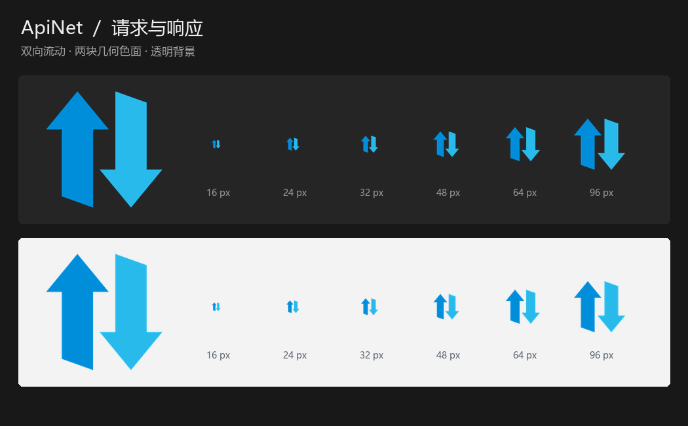
