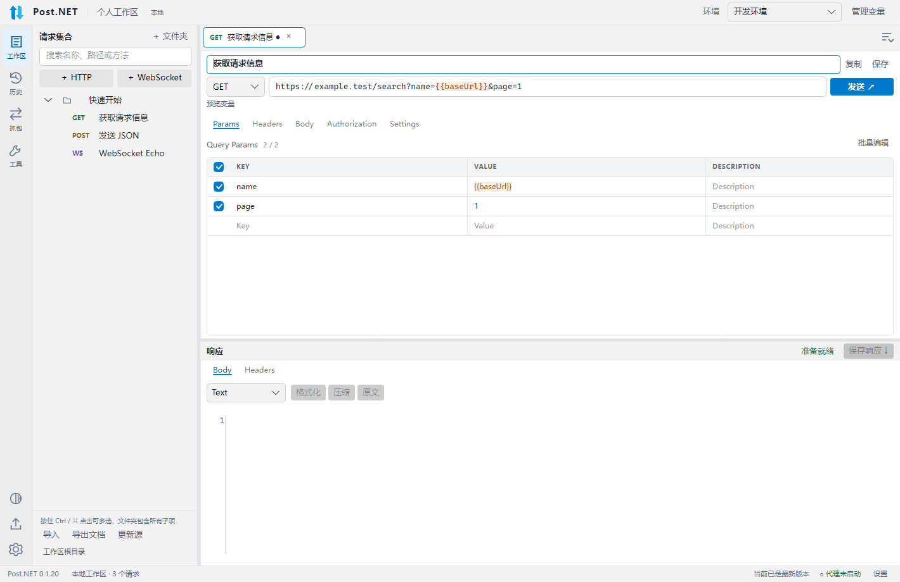

# ApiNet

基于 .NET 10、Avalonia 和 CommunityToolkit.Mvvm 的跨平台网络调试工作台。布局参考 Postman，采用 VS Code 风格的紧凑界面，提供深色和浅色主题。

[下载安装包](https://github.com/coolqingcheng/ApiNet/releases/latest) · [CI 构建](https://github.com/coolqingcheng/ApiNet/actions) · [问题反馈](https://github.com/coolqingcheng/ApiNet/issues)


截图使用 Avalonia Headless + Skia 渲染真实界面，响应来自测试中的本地 HTTP 服务。

## 安装

| 系统 | 架构 | 下载文件 |
| --- | --- | --- |
| Android 8.0+ | ARM64 / x86_64 | `ApiNet-android-arm64.apk` / `ApiNet-android-x64.apk` |
| Windows | x64 / ARM64 | 对应架构的 `Setup.exe` |
| Linux | x64 / ARM64 | 对应架构的 `.AppImage`，执行前使用 `chmod +x` |
| macOS | Intel / Apple Silicon | 对应架构的 `.dmg` 或 `Portable.zip`，将应用复制到 Applications |

安装包自带运行时，无需安装 .NET。桌面包均未签名，不通过应用商店分发；Android APK 使用项目签名密钥，安装时由系统确认。macOS 首次打开时，在“系统设置 → 隐私与安全性”中允许打开；应用应放在当前用户可写的位置，以便更新。Linux 的 CI 构建基线为 Ubuntu 24.04；部分发行版运行 AppImage 需要 FUSE。

Windows 从 0.1.1 起，再次运行 Setup.exe 会直接覆盖安装/修复，同版本也可修复缺失的程序文件，不再弹出“已经安装”的确认。安装时会关闭已有实例，完成后打开应用；工作区、环境、历史和本地 CA 保留在独立的数据目录。命令行支持 `--silent`（不自动启动）、`--no-start`、`--installto <目录>` 和 `--log <文件>`。

## Android 手机和平板

Android 使用 Avalonia.Android 的独立启动入口，手机提供抽屉导航、请求切换、Params/Headers/Body/认证/响应分区，WebSocket 提供消息/发送/握手分区，平板停靠左侧导航。工具面板在窄屏上下排列，支持深浅主题、横竖屏和 44dp 触控按钮。

支持 HTTP/WebSocket、文件夹、环境变量、历史、JSON/在线 Swagger 导入、OpenAPI 导出、文件上传和响应保存。文件通过 Android 系统选择器访问，不需要读取整个存储的权限；选择的上传文件复制到应用私有目录，保存的请求可在重启后继续使用。Android 沙箱无法读取其他应用的本地数据库，Postman/ApiPost 请先导出 JSON 再导入。同一文档重新选择可增量合并；文件导入的“刷新”读取已导入副本，在线来源刷新会重新下载。

Android 抓包使用前台显式 HTTP 代理，不提供 VPN 全局抓包或后台常驻；HTTPS 解密仍需要客户端信任 CA。移动端提供证书另存为。Android 更新从同一 GitHub Release 下载对应 APK，校验 SHA256 后调用系统安装界面，需要用户允许此应用安装更新。没有桌面托盘和“退出时替换程序”的流程。

桌面继续使用 Native AOT；Android 使用 .NET for Android 与 Profiled AOT。手机使用 ARM64 包，x86_64 包适用于相应设备和模拟器。Android 项目单独构建，因此运行桌面解决方案测试无需安装 Android workload。

```sh
dotnet workload install android
dotnet build src/ApiNet.Android/ApiNet.Android.csproj -r android-arm64
```

发布需要 Android SDK 36、JDK 21 与私有签名密钥，运行 `scripts/publish-android.ps1`。GitHub Actions 使用 `ANDROID_KEYSTORE_BASE64`、`ANDROID_SIGN_PASSWORD` 两个仓库 Secret；密钥不进入仓库。后续版本必须沿用同一密钥才能覆盖安装。APK 和桌面包统一发布到 Releases。

## 启动

安装 .NET 10 SDK 后，在项目目录运行：

```sh
dotnet restore
dotnet run --project src/ApiNet.Desktop
```

测试（本地 IndexedDB 解码集成测试另需 PATH 中有 Node.js 22；正式应用优先使用已安装原软件自带的 Electron，无需用户另装 Node.js）：

```sh
dotnet test ApiNet.sln
```

UI 测试通过 Avalonia Headless + Skia 渲染真实 XAML，快照保存在 `artifacts/screenshots`。这些是无窗口渲染快照，不代表已在六种系统/架构上完成实机验证。

测试覆盖真实 HTTP/HTTPS、WebSocket、代理、增量导入、SQLite、文件上传/下载、URL 与参数双向同步、文本工具及 MVVM/界面渲染。六个平台的 Native AOT 安装包由 GitHub Actions 构建，实际结果见对应的工作流。自动化测试不等于所有系统的安装和升级流程均已完成实机验证。

v0.1.0 验证记录：

- Windows、Linux、macOS 均通过 32 项自动化测试（24 项服务/网络测试 + 8 项桌面测试）。
- 六个 RID 的 Native AOT 编译、Velopack 打包及 Release 上传全部成功，见[发布工作流](https://github.com/coolqingcheng/ApiNet/actions/runs/42586154097)。
- Windows x64 原生程序已在本机验证启动、工作区数据库创建和正常退出。
- 使用 Velopack 测试定位器模拟旧版本，已从公开 GitHub Releases 检查、下载并校验真实的 Windows x64 更新包，无需访问令牌；这项检查未执行应用替换和重启。

v0.1.1 的[发布工作流](https://github.com/coolqingcheng/ApiNet/actions/runs/42589146970)已完成六个平台打包，Windows/Linux/macOS 均通过 35 项测试。Windows x64 另执行了真实安装集成测试：从 0.1.0 覆盖升级、同版本再次安装、缺失文件修复，以及旧数据库、WAL、本地 CA 和修复后新增数据的保留，全部通过。

v0.1.2 的[发布工作流](https://github.com/coolqingcheng/ApiNet/actions/runs/42597343331)已完成六个平台的 Native AOT 打包及发布；Windows/Linux/macOS 的[测试工作流](https://github.com/coolqingcheng/ApiNet/actions/runs/42597319162)均通过 51 项测试（41 项服务/网络 + 10 项桌面）。Windows x64 另通过从 0.1.0 覆盖升级、同版本修复及数据库/WAL/CA 保留测试。六个架构的公开更新索引均指向 0.1.2，使用模拟旧版本定位器已从 GitHub 无令牌检查、下载并校验 Windows x64 更新包；该下载验证不执行应用替换或重启。

v0.1.3 的[测试工作流](https://github.com/coolqingcheng/ApiNet/actions/runs/42603067258)在 Windows/Linux/macOS 均通过 69 项自动化测试（51 项服务/网络 + 18 项桌面），覆盖文件上传、在线文档、双向参数同步、深浅主题和文本工具。[发布工作流](https://github.com/coolqingcheng/ApiNet/actions/runs/42603098585)已完成六个平台的 Native AOT 打包和发布，Windows x64 的 0.1.0 → 0.1.3 覆盖升级、重复修复及数据库/WAL/CA 保留验证均通过。六个公开更新索引已核对为 0.1.3，并使用模拟旧版本定位器，从 GitHub 无令牌下载并校验 Windows x64 更新包；这项客户端验证不执行应用替换或重启。

## 已实现

- 多级文件夹：新建、重命名、删除、拖动移动；请求支持 HTTP 和 WebSocket。
- 每个请求独立标签页；单击打开、保存、复制、关闭与草稿恢复；支持 Ctrl+N、Ctrl+S、Ctrl+W。
- HTTP 方法、URL 与 Params 双向同步，Query/Header/Form 参数采用 KEY/VALUE 表格，可增删和启用；支持重复查询参数、Bearer Token、重定向控制、发送动画、取消和响应查看。
- URL、参数、Header、认证和请求体中的 `{{变量}}` 高亮；JSON/XML/HTML 语法高亮和 JSON/XML 格式化，支持 JSON、XML、Text、HTML、JavaScript 请求体类型。显式填写的 Content-Type 优先于类型默认值；Multipart 保留客户端生成的边界。
- Multipart 混合文本与文件上传，支持同名字段上传多个文件、变量文件路径、文件选择与流式发送。
- 深色/浅色主题，一键切换并记住选择；输入框、参数表格和代码高亮随主题变化。
- 本地工具：JSON 格式化/压缩、URL 参数编码/解码、UTF-8 Base64 编码/解码、复制结果与结果填回输入。
- 文件响应完整流式接收，自动提示保存到本地；取消选择后仍可点击“保存响应”。文本响应也可保存原始内容，无需重新发送请求。
- WebSocket：ws/wss、握手 Headers、子协议、文本/JSON、Base64 二进制、双向消息及会话历史。
- 公共变量及环境变量，使用 `{{baseUrl}}`、`{{token}}` 等引用；支持嵌套引用，缺失或循环引用会阻止发送。
- SQLite 保存工作区和历史；历史可按时间、方法、环境、执行结果、URL/名称/文件夹关键词筛选，恢复后不会自动发送。
- Swagger 2.0、OpenAPI 3.0/3.1 JSON 支持从本地文件或在线 HTTP/HTTPS 链接导入到选定文件夹；按首个 tag 分组；导入源绑定、增量更新、字段冲突预览、来源移除标记。
- Postman Collection v2 / v2.1、旧版自动备份、环境/公共变量，以及 ApiPost 项目/单请求 JSON 导入；保留目录、请求、启用状态、原始请求体和表单文本/文件字段。
- 检测本机 ApiPost / Postman，在导入窗口选择后直接读取本地数据副本；支持本地导入源刷新及增量合并。
- 导出 OpenAPI 3.0.3，保留相关模型引用，通过 `x-apinet-*` 扩展恢复文件夹及 WebSocket 配置。
- 本地 HTTP/1.1 正向代理、HTTPS CONNECT 隧道、可选 HTTPS 解密、WebSocket 帧转发及查看、抓包转调试。
- 关闭时退出或隐藏到托盘；Windows/macOS 提供托盘菜单，Linux 关闭到托盘选项当前回退为最小化窗口。
- Velopack 检查更新、后台自动下载、立即重启升级/退出时升级；检查及下载状态显示在底部状态栏，仅更新下载就绪后弹出升级选择。开发运行不会尝试安装更新。

## 基本使用

左侧选择文件夹后新建请求，或点击“导入”/右键“导入到此文件夹”。选择“工作区根目录”后，可在根目录新建文件夹或导出整个工作区。每个导入源保存文件路径、在线 JSON 地址或本机数据目录，再次导入同一来源到同一文件夹会增量更新；文件迁移时需重新选择导入源。

在顶部“管理变量”中配置公共变量和开发/测试等环境。当前环境覆盖公共变量。导入的新服务会在需要时创建独立的 `import_xxxxxx.baseUrl`，避免复用已有服务地址。路径参数如 `{{id}}` 需要在变量中配置。

Query 和 Headers 使用带 KEY/VALUE 表头与分隔线的表格编辑，点击“添加参数”或每行的删除按钮增删。粘贴/编辑 URL 中的查询参数会自动填入 Params，编辑 Params 也会更新 URL；重复 key、空值、`{{变量}}` 和 `#fragment` 均保留。取消勾选会从 URL 中移除此项，但在表格中保留供再次启用，实际发送不会重复追加。Query 值在解析变量后进行 URL 编码。

Body 类型会自动设置默认 Content-Type，Headers 中手动指定的值会覆盖默认值；Multipart 的 Content-Type 和 boundary 统一由客户端生成，避免导入的裸 Content-Type 破坏上传。JSON/XML 高亮在编辑期间生效，`{{变量}}` 单独以橙色突出显示。输入框具有一致的左右留白和焦点边框。

Body 另支持 `Form URL Encoded` 和 `Multipart`。选择 Multipart 后，每行可在 `Text` / `File` 间切换；File 行点击“选择文件…”选择本机文件。相同 key 添加多条 File 行即可上传多个文件，也可与文本字段混合。文件按流读取，变量在读取/编码前解析；文件不存在会提示重新选择，取消请求会停止上传。Form URL Encoded 不支持文件，选中 File 行时会提示改用 Multipart。



左侧 `◐` 按钮可立即切换深色/浅色，或在设置中选择主题，重启后恢复。左侧“工具”提供 JSON 格式化/压缩、URL 编码/解码和 Base64 编码/解码，支持复制结果、清空与结果填回输入，切换工具不会关闭请求标签页。URL 工具按参数组件编码，解码时将 `+` 还原为空格。


修改请求后点击保存或 Ctrl+S。退出应用会保留未保存草稿，重启后恢复标签页；网络连接不会自动重连。历史恢复的数据可能已脱敏，重新发送前需补充认证信息。

## 从 ApiPost / Postman 导入

导入窗口自动列出检测到的软件和残留本地数据。选中软件并点击“一键导入”，即可查看预览并导入到当前文件夹，无需先手动导出。也可点击“在线 JSON 链接…”导入 `https://example.com/v3/api-docs` 或 `swagger.json`，或点击“选择 JSON 文件”，导入 Swagger/OpenAPI、Postman Collection/环境/自动备份或 ApiPost 项目 JSON。文件夹绑定多个导入源时，“刷新导入源”会让你选择具体来源。

在线导入需要文档的 JSON 地址，Swagger UI 的 HTML 页面不能直接导入。支持重定向，下载上限 16 MB、超时 30 秒。来源会绑定到所选文件夹，点击“更新源”会重新下载并预览增量合并，保留本地修改，不重复创建相同请求。需要登录或自定义认证的文档可先下载再导入。


本地读取会复制 Chromium IndexedDB 的 LevelDB 文件，校验表、日志和当前清单，再通过原软件自带的 Electron/V8 解码。读取过程不获取原数据库锁，不写入原软件的数据目录，不运行请求或脚本；临时副本在结束后清理。优先读取当前数据库，无法完整读取时可回退到最新的 Postman 自动备份，预览会显示备份文件名，提醒核对数据时间。原软件正在写入时，建议先关闭后再导入。

Windows 检测常见安装位置及卸载注册表，macOS 检测 Applications，Linux 检测常见目录、PATH 和 Postman 的 Snap/Flatpak 数据目录。自定义数据目录、加密数据、尚未同步到本机的云端内容或改变存储结构的新版软件可能无法直接读取，此时使用 JSON 文件导入。本机已验证 ApiPost 8.2.5 的请求/文件夹读取以及 Postman 自动备份的环境导入；其他版本与 macOS/Linux 的真实软件数据仍需实机验证。

支持 Bearer、API Key、固定用户名密码的 Basic 认证和继承认证；含变量的 Basic、OAuth/Digest 等认证需手动配置。脚本、前后置任务、历史、执行结果不迁移；不支持的认证、请求体和 Cookie 参数会在预览中提示。导入的文件项保留字段名、File 类型及来源中的路径，并先停用；点击“选择文件…”确认本机文件后会自动启用。Swagger/OpenAPI 的 multipart binary 和 Swagger 2.0 file 字段也会识别为文件。导出 OpenAPI 使用标准 binary schema，多文件同名字段使用 binary 数组；导出的扩展保留文件字段但清空本机文件路径并停用，接收方重新选文件即可发送。Postman 独立 WebSocket 导出格式暂不支持，普通集合中的 ws/wss URL 会识别为 WebSocket 请求。

增量导入按来源请求标识合并，同一 URL 下的多个请求可分别保留；无标识时使用目录和位置定位，调整此类项目顺序可能被识别为新增。冲突可选保留本地或使用文档值；来源中移除的请求只标记，不自动删除。已有公共/环境变量保留本地值，并显示同名变量提示；新增变量会补入，导入后可在“管理变量”切换环境。不同项目的同名变量需要核对后调整。

## 代理抓包

默认监听 `127.0.0.1:8877`，启动后手动将客户端代理指向此地址。例如：

```sh
curl --proxy http://127.0.0.1:8877 http://example.com
```

HTTPS 默认透传 TLS；需要解密时，在设置中开启 HTTPS 解密，导出 CA 并由用户在客户端信任，再重启代理。程序不自动改写系统代理或信任库。CA 私钥保存在本地应用数据目录的 `certificates` 中。

HTTP 抓包和主动 HTTP 调试分别保留至多 1 MB、4 MB 的响应预览；代理继续转发完整响应，主动请求的完整响应流式写入临时文件供下载，不受预览限制。临时响应在下一次请求、关闭标签或退出时清理，历史不保存临时路径或二进制正文。WebSocket 抓包按帧展示，压缩帧/二进制帧显示 Base64。列表最多显示最近 1000 条抓包，主动 WebSocket 每次会话最多保留 1000 条消息。

## 数据目录

Windows 默认使用 `%LOCALAPPDATA%/ApiNetData` 保存数据，与 `%LOCALAPPDATA%/ApiNet` 中的安装文件分开。0.1.0 的工作区数据库、待提交的 SQLite WAL 和 `certificates` 会自动迁移；迁移不覆盖已有新版数据库，源文件保留到覆盖安装或用户自行清理。其他系统继续使用系统 LocalApplicationData 下的 `ApiNet`。

`workspace.db` 保存配置、草稿和历史。环境变量中的敏感值保存在本机数据库，历史中的常见认证头及标记为敏感的变量值会脱敏。可用 `APINET_DATA_DIR` 环境变量指定独立的数据目录，该目录应位于安装目录之外。Windows 安装日志默认保存在 `%LOCALAPPDATA%/ApiNetSetupLogs/setup.log`。

## Native AOT 发布

发布使用原生 AOT，目标为 `win-x64`、`win-arm64`、`linux-x64`、`linux-arm64`、`osx-x64`、`osx-arm64`。在对应操作系统上用 PowerShell 7 执行：

```powershell
./scripts/publish.ps1 -Rid win-x64 -Version 0.1.4
```

- Windows 需要 Visual Studio C++ 桌面构建工具和 Windows SDK，ARM64 额外需要 ARM64 C++ 工具链。生成未签名 Setup.exe。
- Linux 需要 clang、zlib 开发库和 squashfs-tools，生成 AppImage。CI 的 Linux 基线为 Ubuntu 24.04。
- macOS 需要 Xcode Command Line Tools，生成便携 `.app.zip` 和 `.dmg`。不配置 Developer ID 签名、公证或商店发布。

在仓库 Actions 中运行 **Native AOT packages**，输入递增的 SemVer 版本号（例如 `0.1.4`）。工作流运行测试，构建六个桌面目标和两个 Android 目标，全部成功后发布同名 GitHub Release，同时上传安装包、更新包、架构索引和 SHA256 校验文件。桌面无需签名密钥；Android 需要上文说明的两个签名 Secret。发布使用工作流内置的 `GITHUB_TOKEN`，无需个人访问令牌。本地输出在 `artifacts/releases/{RID}`。

## 在线更新源

更新源固定为本项目的公开 GitHub 仓库，设置中无需填写地址；主窗口标题显示当前安装版本：

```text
https://github.com/coolqingcheng/ApiNet
```

Velopack 直接读取 GitHub Releases，用户无需 GitHub 令牌。CI 的 Actions artifacts 用于构建之间传递文件，应用使用 Release 中的长期下载地址。每个平台有独立通道：`win-x64`、`win-arm64`、`linux-x64`、`linux-arm64`、`osx-x64`、`osx-arm64`；对应 `releases.{通道}.json` 与 `*.nupkg`，不要重命名或删除更新资产。

启动及每四小时检查一次，也可手动检查。检查中、当前已是最新版、失败原因和下载进度都显示在窗口底部，不弹常规提示框。发现新版本后自动下载并校验，再弹出立即重启升级/退出时升级/稍后的选择，同一版本每次启动只自动提示一次；稍后可从底部“安装更新”重新打开。“退出时升级”只在真正退出应用时执行，隐藏到托盘会继续运行。开发运行不安装更新。首版需要先安装正式包；后续发布更高版本即可获得更新。尚未完成六个平台的连续版本安装/升级实机验证。

## 第一版边界

- 代理 HTTPS 解密协商 HTTP/1.1，暂不提供 HTTP/2、HTTP/3、gRPC、透明代理或系统代理自动接管。
- OpenAPI 只接收单文件 JSON 的本地引用；外部引用需预先打包，暂不支持 YAML。Swagger 2.0 的部分复杂 formData、OAuth 流程和 OpenAPI 3.1 JSON Schema 特性需要后续完善。
- OpenAPI 文件不包含抓包、历史和完整环境集。第三方工具重新导出时，可能丢弃 `x-apinet-*` 扩展。
- 历史筛选当前加载最近 1000 条记录；抓包列表为当前运行期间的数据。
- AOT 构建脚本和 CI 已提供；是否成功发布以对应平台的实际构建结果为准。

## 代码结构

```text
src/ApiNet.Desktop          桌面启动入口、托盘与生命周期
src/ApiNet.UI               共享 Views / ViewModels / Services / Styles / Assets
src/ApiNet.Android          Android Activity、文件/更新与移动端启动
src/ApiNet.Core             模型、接口、源生成 JSON 上下文
src/ApiNet.Infrastructure   HTTP、WebSocket、变量、SQLite、OpenAPI、集合/本机导入、更新
src/ApiNet.Proxy            正向代理、HTTP 协议读写、本地 CA
src/ApiNet.Setup            Windows 原生安装入口、覆盖修复和旧数据迁移
tests/ApiNet.Tests          服务与网络集成测试
tests/ApiNet.Desktop.Tests  MVVM 交互及 XAML 渲染测试
```

窗口只组合视图，功能按目录拆分；MainWindowViewModel 的协调命令按 Workspace、History、Capture、OpenApi、Updates 分文件，工具与设置使用独立 View/ViewModel，深浅主题色集中在 ThemePalette.axaml。各请求 Tab 维护自己的状态，网络与存储实现不依赖 Avalonia。
